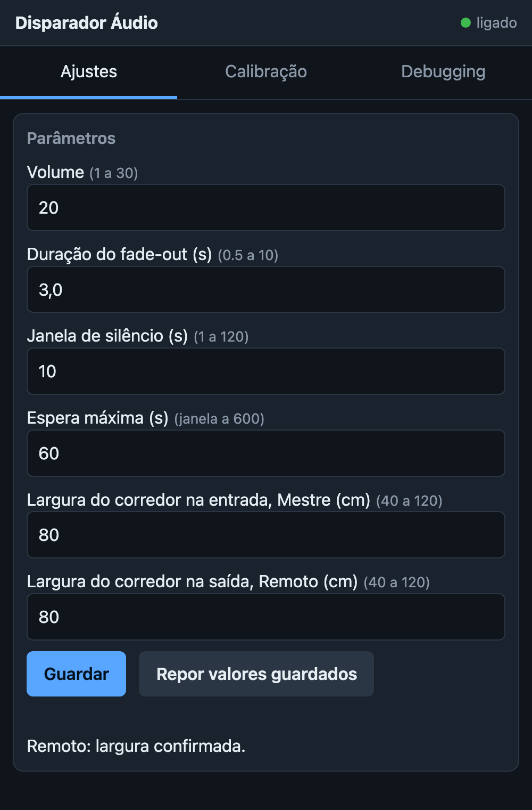
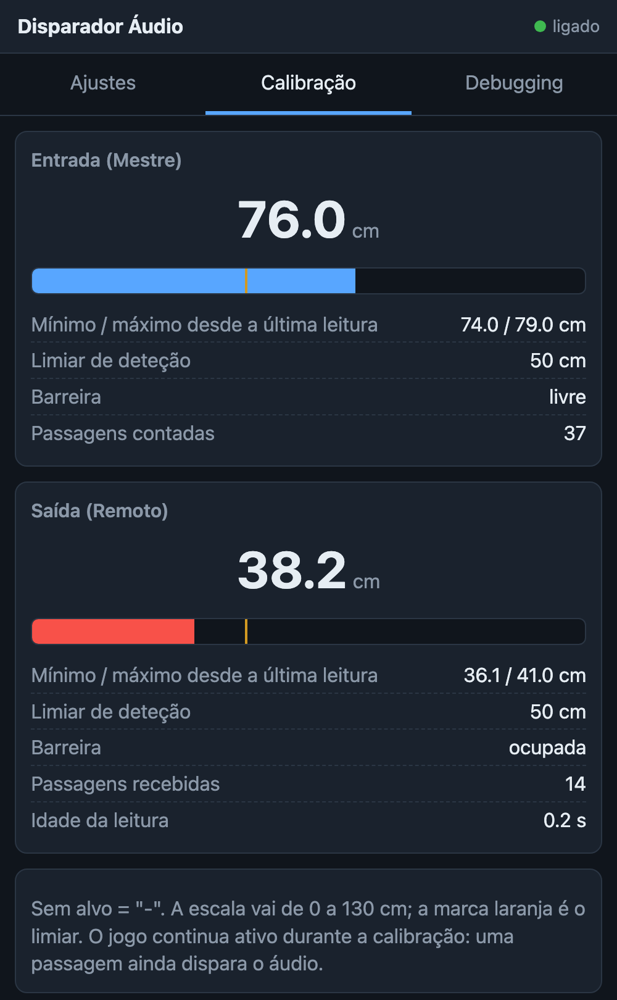
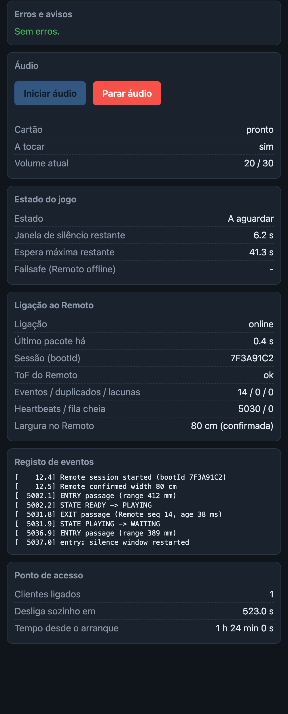

# Manual de utilização — Dispositivo de áudio do corredor

Este manual explica como usar o sistema no dia a dia: o que ele faz, o que significam as luzes e como mudar as definições a partir do telemóvel. A montagem e a atualização do firmware estão no manual de instalação.

## 1. O que o sistema faz

Quando alguém entra no corredor, começa a tocar um áudio em loop. Quando as pessoas saem, o volume desce devagar até zero e o áudio pára. O sistema volta sozinho ao estado inicial e fica pronto para o grupo seguinte. Não é preciso carregar em nada durante o jogo.

O sistema tem dois aparelhos:

| Aparelho | Onde fica | O que faz |
|---|---|---|
| **Mestre** | Entrada | Deteta quem entra, toca o áudio, decide quando parar e tem a página de definições |
| **Remoto** | Saída | Deteta quem sai e avisa o Mestre sem fios |

Cada um tem um sensor de distância apontado de um lado ao outro do corredor. Quando alguém passa à frente do sensor, conta como uma passagem. Uma pessoa parada à frente do sensor conta uma só vez.

## 2. Como funciona

O sistema está sempre num destes estados. O LED do Mestre mostra qual (ver a secção 4).

| Estado | O que acontece |
|---|---|
| **Pronto** | Silêncio. Está à espera de alguém na entrada. Uma passagem na saída é ignorada. |
| **A tocar** | O áudio toca em loop. Está à espera de alguém na saída. Mais passagens na entrada não fazem nada. |
| **A aguardar** | Alguém passou na saída. Começa a contar a **janela de silêncio**. Qualquer passagem, na entrada ou na saída, volta a contar a janela desde o início. |
| **Fade-out** | A janela terminou sem passagens. O volume desce até zero e o áudio pára. |
| **Rearme** | Passo curto (cerca de 1 segundo). O volume é reposto e o sistema volta a Pronto. |

**Se as pessoas não pararem de passar**, a janela de silêncio nunca chegaria ao fim. Por isso existe uma **espera máxima**: conta desde a primeira passagem na saída e, quando acaba, o fade-out arranca de qualquer forma.

**Se alguém entrar durante o fade-out**, o fade-out é cancelado e o volume sobe de novo, depressa, até ao valor definido. O sistema volta a "A tocar" e espera outra passagem na saída. Uma passagem na saída durante o fade-out não faz nada.

## 3. Ligar o sistema

1. Confirme que o **cartão de memória** com o áudio está inserido na unidade de áudio do Mestre (ver a secção 3.1). Tem de estar inserido **antes** de ligar.
2. Ligue o Mestre e o Remoto à alimentação.
3. Espere cerca de 10 segundos. Quando o LED do Mestre fica **verde fixo**, o sistema está pronto.

O sistema arranca sempre em **modo Normal**: a rede Wi-Fi de definições está desligada e o jogo corre sozinho. Se faltar a corrente, as definições ficam guardadas.

### 3.1 O cartão de memória e o ficheiro de áudio

O áudio está num cartão microSD, na unidade de áudio do Mestre. O cartão tem de cumprir estes requisitos:

| Requisito | Valor |
|---|---|
| Tipo de cartão | microSD, **até 32 GB** |
| Sistema de ficheiros | **FAT16 ou FAT32** |
| Formato do áudio | **MP3 ou WAV** |

- **Que ficheiro toca:** o sistema toca a **primeira faixa do cartão**, em loop. A unidade de áudio ordena as faixas pela **ordem em que os ficheiros foram gravados no cartão**, e não pelo nome. A primeira faixa é, por isso, o primeiro ficheiro que foi copiado para o cartão.
- **Recomendação:** deixe só **um ficheiro de áudio** no cartão. Assim não há dúvidas sobre qual toca. Se o cartão tiver vários ficheiros, toca o que foi gravado primeiro.
- **Cartão novo:** cartões com mais de 32 GB, ou formatados noutro sistema de ficheiros (por exemplo exFAT ou NTFS), não são suportados. Se o cartão não for reconhecido, o mais provável é aparecer o erro de cartão da secção 7.
- **Trocar o ficheiro ou o cartão:** desligue o Mestre da alimentação, troque o cartão ou o ficheiro e volte a ligar. O cartão só é verificado no arranque.

## 4. O que significa o LED do Mestre

O LED está no Mestre. Os erros têm prioridade sobre o estado do jogo.

| LED | Significado |
|---|---|
| Verde fixo | Pronto |
| Azul fixo | A tocar |
| Ciano fixo | A aguardar |
| Amarelo a piscar devagar | Fade-out |
| Amarelo fixo | Rearme |
| Vermelho fixo | Problema com o cartão de áudio |
| Vermelho a piscar depressa | O sensor da entrada não dá leituras |
| Laranja a piscar devagar | O Remoto não está ligado |
| Magenta a piscar devagar | O sensor do Remoto tem uma falha |

Quando a rede Wi-Fi de definições está ligada, aparecem **pulsos brancos** por cima da cor atual:

| Pulsos brancos | Significado |
|---|---|
| 1 pulso longo a cada 3 segundos | Rede ligada, ainda ninguém ligado |
| 2 pulsos curtos a cada 3 segundos | Rede ligada, há um telemóvel ligado |
| 3 piscas brancos rápidos | O toque longo no botão foi reconhecido |

## 5. Abrir a página de definições

A página de definições está no Mestre e abre-se com o telemóvel.

1. No Mestre, carregue no botão e **mantenha 2 segundos** (toque longo). O LED faz 3 piscas brancos e passam a aparecer os pulsos brancos.
2. No telemóvel, ligue-se à rede Wi-Fi **EscapeRoom-Audio**, com a palavra-passe **mission2escape**.
3. Abra o navegador e escreva **http://192.168.4.1** (com `http`, não `https`).

Se o telemóvel avisar que a rede não tem internet, mantenha a ligação: a página funciona sem internet.

- Podem ligar-se até 4 telemóveis ao mesmo tempo.
- O **jogo continua a funcionar normalmente** enquanto a rede está ligada.
- A rede **desliga-se sozinha** após 10 minutos sem a página ser usada. Um telemóvel ligado à rede sem a página aberta não conta como uso.
- Para desligar antes, faça outro toque longo de 2 segundos no botão do Mestre.
- Se faltar a corrente e voltar, a rede começa desligada.

## 6. A página de definições

O cabeçalho mostra "ligado" quando o telemóvel está a falar com o Mestre e "sem ligação" quando perdeu a ligação. A página tem três separadores.

*As imagens deste manual são ilustrativas: mostram a página real, mas com valores simulados.*

### 6.1 Ajustes

Aqui mudam-se os valores. Cada campo mostra entre parênteses os limites aceites.

| Definição | Valor de fábrica | Limites | O que faz |
|---|---|---|---|
| Volume | 20 | 1 a 30 | Volume do áudio |
| Duração do fade-out | 3 s | 0,5 a 10 s | Quanto tempo o volume demora a descer até zero |
| Janela de silêncio | 10 s | 1 a 120 s | Tempo sem passagens depois de alguém sair até começar o fade-out |
| Espera máxima | 60 s | até 600 s, nunca menos do que a janela | Tempo máximo desde a primeira passagem na saída até o fade-out arrancar, mesmo com passagens |
| Largura do corredor na entrada (Mestre) | 80 cm | 40 a 120 cm | Distância de lado a lado do corredor onde está o sensor da entrada |
| Largura do corredor na saída (Remoto) | 80 cm | 40 a 120 cm | O mesmo, para o sensor da saída |

O **fade-in** (a subida do volume quando alguém entra durante o fade-out) é rápido e fixo. Não se ajusta.

**A largura define a deteção.** Cada sensor mede a distância até ao que está à sua frente. Com o corredor vazio, mede a distância até à parede do outro lado, que é a largura do corredor (de fábrica, 80 cm). Quando alguém passa, a distância medida diminui. O sistema considera que há alguém quando a distância medida fica **abaixo do limiar**, e o limiar é a largura menos 30 cm. Com a largura de fábrica, o limiar é 50 cm: há deteção quando o sensor mede menos de 50 cm.

Para guardar:

1. Altere os campos que quiser.
2. Carregue em **Guardar**. Todos os valores são verificados em conjunto. Se algum não for aceite, a página diz qual e nada é guardado.
3. As definições ficam guardadas mesmo depois de desligar a corrente.

O botão **Repor valores guardados** volta a mostrar os valores que estão guardados no aparelho e descarta o que escreveu e não guardou. **Não repõe os valores de fábrica.**

Quando muda a largura da saída, a página mostra se o Remoto já confirmou. Se estiver desligado, o valor é enviado assim que ele voltar a ligar.

### 6.2 Calibração

Mostra, em direto, o que cada sensor está a medir: um cartão para a **entrada (Mestre)** e outro para a **saída (Remoto)**.

- O número grande é a distância medida, em centímetros. Um traço (-) quer dizer que não há nada à frente do sensor.
- A barra vai de 0 a 130 cm. A marca laranja é o limiar de deteção.
- A barra fica vermelha quando a barreira está **ocupada** (alguém à frente do sensor) e azul quando está **livre**.
- **Mínimo / máximo desde a última leitura** mostra os extremos medidos desde a atualização anterior.
- **Passagens contadas** (entrada) e **passagens recebidas** (saída) mostram quantas passagens o sensor registou.
- No cartão da saída, **Idade da leitura** mostra há quanto tempo chegou a última leitura do Remoto.

Para calibrar, ponha-se à frente de cada sensor e veja a distância. A largura certa é a distância do sensor à parede do outro lado, medida sem ninguém no corredor.

**Atenção:** o jogo continua ativo durante a calibração. Uma passagem ainda faz tocar o áudio.

### 6.3 Debugging

Mostra o estado do sistema, para perceber se está tudo bem ou o que falhou.

- **Erros e avisos:** lista os problemas atuais. Diz "Sem erros." quando está tudo bem. A secção 7 explica cada um.
- **Áudio:**
  - **Iniciar áudio:** só funciona em Pronto e faz o mesmo que uma entrada. O botão fica desativado se houver problema com o cartão.
  - **Parar áudio:** pára de imediato, repõe o volume, passa pelo Rearme e volta a Pronto. Só funciona quando o áudio está a tocar.
  - Mostra ainda o estado do cartão, se está a tocar e o volume atual.
- **Estado do jogo:** o estado atual e os tempos que faltam para a janela de silêncio e para a espera máxima.
- **Ligação ao Remoto:** se está online, há quanto tempo chegou o último sinal, o estado do sensor do Remoto, a largura que o Remoto está a usar e contadores de eventos.
- **Registo de eventos:** as últimas 200 mensagens do sistema (passagens, mudanças de estado, erros). O registo apaga-se quando o Mestre reinicia. O primeiro registo de cada arranque indica o motivo do reinício.
- **Ponto de acesso:** quantos telemóveis estão ligados, quanto falta para a rede desligar sozinha e há quanto tempo o Mestre arrancou.

## 7. Erros e o que fazer

| Mensagem na página | LED | O que significa | O que fazer |
|---|---|---|---|
| Cartão de áudio em falta ou unidade sem resposta | Vermelho fixo | O Mestre não encontra o cartão ou a unidade de áudio não responde | Desligue o Mestre, confirme que o cartão está bem inserido na unidade de áudio e que cumpre os requisitos da secção 3.1, e volte a ligar |
| Cartão de áudio removido | Vermelho fixo | O cartão foi retirado com o sistema ligado | Volte a inserir o cartão. O aviso desaparece. Se o Mestre tiver arrancado sem cartão, desligue e volte a ligar |
| ToF da entrada (Mestre) sem dados | Vermelho a piscar depressa | O sensor da entrada não está a medir | Verifique o cabo do sensor no Mestre e reinicie. Se o LED ficar assim desde o arranque, o Mestre fica parado até ser reiniciado |
| Remoto sem ligação | Laranja a piscar devagar | O Mestre não recebe sinal do Remoto há mais de 3 segundos | Verifique se o Remoto tem alimentação |
| ToF da saída (Remoto) com falha | Magenta a piscar devagar | O sensor do Remoto não está a medir | Verifique o cabo do sensor no Remoto e reinicie-o |
| ESP-NOW não iniciado | — | A ligação sem fios entre os aparelhos não arrancou | Reinicie o Mestre desligando e voltando a ligar |
| Largura do Remoto ainda por confirmar | — | O Remoto ainda não confirmou a largura nova | Espere uns segundos. Se continuar, veja se o Remoto está ligado |

**Se o Remoto estiver desligado com o áudio a tocar**, o Mestre não sabe quando as pessoas saem. Para o áudio não ficar preso, o fade-out arranca quando a **espera máxima** acaba, contada desde que o Remoto ficou sem ligação ou desde que o áudio começou, o que acontecer mais tarde. A entrada continua a tocar o áudio normalmente.

## 8. Problemas comuns

| Problema | Causa provável | O que fazer |
|---|---|---|
| O áudio não toca quando alguém entra | Problema com o cartão, ou o sistema ainda não terminou o Rearme | Veja o LED. Vermelho fixo é o cartão (confirme os requisitos da secção 3.1). Se estiver a tocar ou em Rearme, espere |
| Toca um áudio diferente do esperado | Há mais de um ficheiro no cartão | O sistema toca o ficheiro gravado primeiro no cartão. Deixe só o ficheiro certo no cartão (secção 3.1) |
| O áudio não pára depois de as pessoas saírem | A passagem na saída não foi detetada, ou o Remoto está desligado | Veja o LED (laranja é o Remoto offline). No separador **Calibração**, confirme que o Remoto mede e deteta. Se estiver preso, use **Parar áudio** no separador Debugging |
| O áudio pára cedo demais | A janela de silêncio é curta para o ritmo do grupo | Aumente a **janela de silêncio** nos Ajustes |
| O áudio demora a parar | A janela de silêncio ou a espera máxima são longas | Diminua-as nos Ajustes |
| Não consigo abrir a página | A rede está desligada, ligou-se à rede errada ou usou `https` | Confirme os pulsos brancos no LED (se não houver, faça o toque longo de 2 s), ligue-se à rede **EscapeRoom-Audio** e escreva **http://192.168.4.1** |
| A página fica "sem ligação" | O telemóvel saiu da rede, ou a rede desligou-se sozinha ao fim de 10 minutos | Volte a ligar a rede com o toque longo e reabra a página |
| Uma pessoa foi contada duas vezes, ou não foi contada | A largura do corredor está mal definida | Confirme a largura e a distância medida no separador **Calibração** |

## 9. Resumo

- **Ligar:** cartão inserido, ligar os dois aparelhos, esperar o LED verde.
- **Abrir as definições:** toque longo de 2 s no Mestre, rede **EscapeRoom-Audio**, palavra-passe **mission2escape**, endereço **http://192.168.4.1**.
- **Mudar valores:** separador Ajustes, depois Guardar.
- **Ver o que se passa:** separador Debugging.
- **Se algo falhar:** veja a cor do LED e a secção 7.
